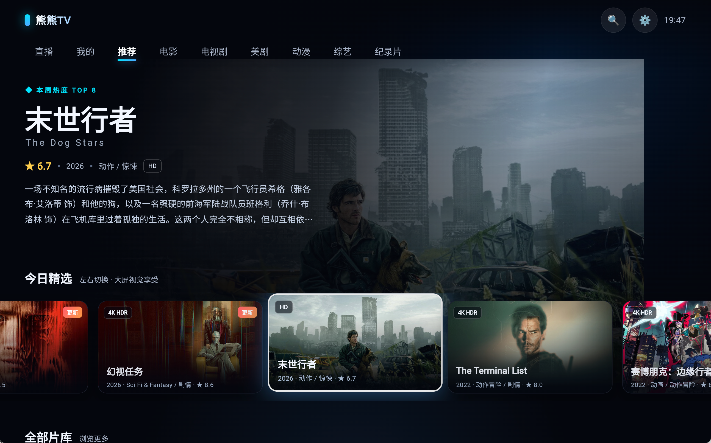
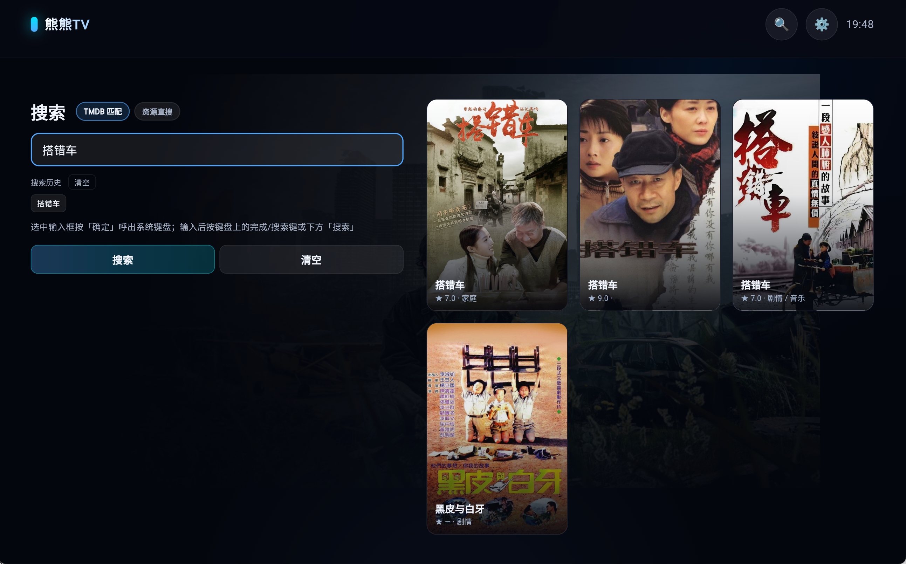

# 熊熊TV (Bear TV)

面向 **Android TV / 电视盒子** 的 Flutter 影视聚合客户端：TMDB 提供目录与元数据，播放时由使用者自行配置的 MacCMS 采集源按片名解析地址，配合遥控器焦点导航、弹幕、直播与本地续播。

> **本项目不内置、不存储、不分发任何影视资源。** 仓库与发布产物中不包含采集源、API Key、代理地址或弹幕凭证；所有播放地址均由使用者自行配置的第三方接口在运行时解析，本项目仅提供界面与播放器。

## 截图

<table>
  <tr>
    <td width="50%"><br><sub>首页 · 推荐</sub></td>
    <td width="50%"><br><sub>搜索 · 历史与 TMDB 匹配</sub></td>
  </tr>
</table>

## 平台

- Android 7.0+（`minSdk 24`），面向 Android TV 与遥控器；触屏可点击，但布局按横屏电视设计。
- 当前仅维护 Android 端，其他平台目录未纳入仓库。

## 功能

### 内容发现

- TMDB v3 目录：推荐、电影、电视剧、美剧、动漫、综艺、纪录片，中文元数据与高清海报。
- 每个 tab 独立缓存数据与滚动位置，切回不重新加载；触底自动分页。
- Hero 大图、横向 Rail、瀑布流片库、焦点跟随动态背景。

### 播放

- 播放地址由已启用的采集源按片名并发搜索，精确匹配优先，取首个可播线路起播。
- 选集、多线路、跨源「切换资源」；单源失败自动降级。
- 选集优先显示源站标题（综艺期数、剧集名称），标题缺失或只有编号时回退为「第 N 集 / 第 N 期」。
- 续播（>5s 才恢复）、倍速、片头片尾跳过，按片名记忆。
- 全屏遥控：OK 播放/暂停，←/→ 快进退 10 秒，↓ 呼出选集浮层，↑ 设置菜单，`F` 切换全屏。
- 未配置任何采集源时，播放页会提示前往设置添加。

### 播放内核

- `video_player` + **fvp/libmdk** 后端（非 ExoPlayer）。
- 起播只需缓冲 3 秒，后台最多预读 90 秒；开启解复用缓存与 HTTP 断线重连，弱网下减少卡顿。
- 进度条同时展示播放进度与已缓冲区间。

### 弹幕

- 兼容 dandanplay 的弹幕服务（如 [danmu_api](https://github.com/huangxd-/danmu_api)），播放页叠加渲染。
- 可配置开关、显示区域、字号与速度；未配置服务地址或 token 时自动停用并提示。

### 直播

- 支持 M3U/M3U8 播放列表，按 `group-title` 分组，多源切换。
- 频道可用性探测，失效频道给出标记。

### 搜索

- TMDB 多类型搜索。
- 内置离线拼音输入法，也可切换系统输入法；保留搜索历史。

### 本地数据

- 标量配置（Key、开关、自定义源、弹幕配置）使用 `shared_preferences`。
- 续播记录使用 Hive（`playback` box），每个条目一条 JSON 字符串。

## 技术方案

- **状态**：`AppScope`（`InheritedNotifier<AppController>`）+ `AppController`（`ChangeNotifier`），不引入第三方状态库。
- **数据边界**：`ContentRepository` 只负责 TMDB 目录；可播放地址由 `VodRepository` 走采集源解析，二者解耦。
- **播放边界**：`PlayerController` 抽象 + `VideoAdapter` 实现，测试使用 `MockPlayerController`。
- **失败降级**：采集源、弹幕、直播均按「单源失败静默跳过」处理，不阻塞主流程。
- **资源占用**：AOT 编译；图片 `ImageCache` 限制 60 MB / 200 条，适配低内存盒子。

```text
TMDB 目录 / 搜索 ──► 播放页 ──► 按片名并发搜索已启用采集源
                                   │
                                   ├─ 命中 → 解析线路与选集 → fvp 播放
                                   └─ 未命中 → 提示切换资源或添加源
```

## 快速开始

前置：Flutter 3.47.x、JDK 17、Android SDK；Android TV / 盒子或模拟器。

```bash
git clone <repo-url> && cd BearTv-app
flutter pub get
flutter run -d <deviceId>
```

不配置任何密钥也能启动：应用会引导填写 TMDB API Key，采集源、直播源与弹幕在设置页配置。

构建分架构 release APK：

```bash
flutter build apk --release --split-per-abi
# 产物：build/app/outputs/flutter-apk/app-<abi>-release.apk
```

- `arm64-v8a`：绝大多数电视盒子（首选）
- `armeabi-v7a`：较老的 32 位设备
- `x86_64`：模拟器 / x86 设备

## 配置

### 方式一：应用内设置

首次启动按提示填写 TMDB v3 API Key；设置页可管理采集源、直播源、弹幕、代理与搜索输入法。这些配置只保存在本机。

### 方式二：编译期注入（本地打包免手动填写）

```bash
cp secrets.example.json secrets.json
# 编辑 secrets.json 后：
flutter build apk --release --split-per-abi --dart-define-from-file=secrets.json
# 调试：
flutter run --dart-define-from-file=secrets.json
```

`secrets.json` 已加入 `.gitignore`，不要提交。字段：

| 字段 | 说明 | 留空时 |
| --- | --- | --- |
| `TMDB_API_KEY` | TMDB v3 Key，首次启动作为默认值 | 启动后引导填写 |
| `TMDB_PROXY_BASE` | TMDB 反代 origin（拼 `<origin>/3`、`<origin>/t/p`） | 直连 TMDB |
| `CMS_SITES_JSON` | 采集源 JSON 数组字符串 | 无内置源 |
| `DEFAULT_SELECTED_JSON` | 默认启用的源 id 数组 | 全选 |
| `DANMAKU_BASE_URL` | 弹幕服务地址 | 弹幕停用 |
| `DANMAKU_TOKEN` | 弹幕服务 token | 弹幕停用 |
| `IPTV_PLAYLIST_URL` | 默认直播源 M3U 地址 | 直播页为空 |
| `IPTV_PLAYLIST_NAME` | 默认直播源名称 | `默认直播源` |

> 编译期注入只是把值写进 AOT 常量，**不是加密**，可从二进制还原；请勿在公开产物中携带他人凭证。
> 仓库与 GitHub Actions 构建均使用空默认值，公开下载的 APK 不含任何资源或密钥，需要用户在应用内自行配置。

### 采集源格式

`CMS_SITES_JSON` 是一个 JSON 数组，每项字段：

| 字段 | 必填 | 说明 |
| --- | --- | --- |
| `id` | 是 | 唯一标识，`DEFAULT_SELECTED_JSON` 用它指定默认启用项 |
| `name` | 是 | 设置页显示的名称 |
| `api` | 是 | MacCMS apiv3 接口，如 `https://host/api.php/provide/vod` |
| `detail` | 否 | 特殊源的详情页前缀，用于 HTML 抓取 m3u8 兜底 |

可读形式：

```json
[
  {
    "id": "demo",
    "name": "示例资源",
    "api": "https://example.com/api.php/provide/vod"
  },
  {
    "id": "demo-detail",
    "name": "示例特殊源",
    "api": "https://example.com/api.php/provide/vod",
    "detail": "https://example.com/voddetail/"
  }
]
```

写入 `secrets.json` 时，整个数组需要作为一个字符串（引号转义）：

```json
{
  "CMS_SITES_JSON": "[{\"id\":\"demo\",\"name\":\"示例资源\",\"api\":\"https://example.com/api.php/provide/vod\"}]",
  "DEFAULT_SELECTED_JSON": "[\"demo\"]"
}
```

也可以完全不写配置，直接在「设置 → 自定义资源站配置」里填名称和 apiv3 地址，最多 5 个。

### 相关资源

- **TMDB API Key 申请与文档**：<https://developer.themoviedb.org/docs/getting-started>
- **TMDB 反向代理**（自建，用于无法直连 TMDB 的网络）：<https://github.com/imaliang/tmdb-proxy>
- **弹幕服务**（dandanplay 兼容，需自行部署）：<https://github.com/huangxd-/danmu_api>
- **CMS 采集源**：本项目不提供、不推荐任何具体源，请自行搜索并确认其合法性与可用性。

## 构建与发布

推送 `v*` tag 会触发 `.github/workflows/release.yml`：

```bash
git tag -a v0.1.0 -m "v0.1.0"
git push origin v0.1.0
```

工作流安装 Flutter 3.47.5 与 JDK 17，执行 `flutter build apk --release --split-per-abi`，并将三个 APK 以该 tag 发布为 GitHub Release。

版本号在 `pubspec.yaml`：`version: 0.1.0+1` 对应 Android `versionName=0.1.0`、`versionCode=1`。建议 tag 与 `versionName` 一致，每次发版递增 `versionCode`。

## 遥控器按键

| 按键 | 行为 |
| --- | --- |
| 方向键 | 移动焦点，自动滚动到可见区域 |
| OK / 回车 / 空格 | 激活当前焦点项；播放页聚焦播放器时进入全屏 |
| `F` | 播放页切换全屏 |
| 全屏 · OK | 播放 / 暂停 |
| 全屏 · ← / → | 快退 / 快进 10 秒（连按累加） |
| 全屏 · ↑ | 呼出播放设置菜单 |
| 全屏 · ↓ | 从底部呼出选集浮层（有下一集时顶部提供「播放下一集」快捷键；无可选集时改为显示进度条） |
| 返回 / Esc | 全屏 → 退出全屏；播放页 → 首页；设置、搜索 → 返回 |

## 工程结构

```text
lib/
├── main.dart                 # fvp 注册、ImageCache 调优、启动
├── app.dart                  # 根组件、Shell、全局按键、页面切换
├── core/                     # AppController、弹幕/直播控制器、主题、编译期配置
├── data/
│   ├── tmdb/                 # 目录与搜索
│   ├── vod/                  # 采集源管理与地址解析
│   ├── iptv/                 # M3U 解析与频道探测
│   ├── danmaku/              # 弹幕客户端
│   ├── history_store.dart    # Hive 续播记录
│   ├── settings_store.dart   # 配置读写
│   └── kv_store.dart         # SharedPreferences 适配
├── player/                   # PlayerController 抽象 + VideoAdapter(fvp)
├── screens/                  # 首页、播放、搜索、直播、设置、启动
└── widgets/                  # 焦点、卡片、弹幕层、屏幕键盘等
```

## 已知限制

- 采集源为第三方公开接口，可能失效或限速；播放失败请在播放页切换资源。
- 不配置采集源时只能浏览 TMDB 目录，无法播放。
- 公开 Release 的 APK 使用 debug 签名，仅适合测试；正式分发请配置自己的 keystore。
- 仅适配 Android TV 横屏与遥控器，触屏不是主要目标。

## 免责声明

本项目不内置、不存储、不分发任何影视内容或播放源，也不提供破解或绕过版权保护的能力。所有目录数据来自 TMDB，播放地址由使用者自行配置的第三方接口在运行时解析，与本项目无关。

请仅将本项目用于个人学习与技术研究，遵守当地法律法规并尊重版权；因使用第三方接口产生的后果由使用者自行承担。
